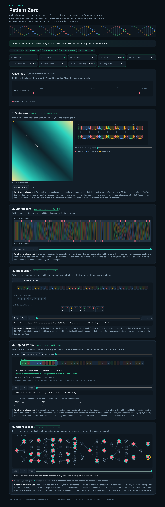

# Assignment 4. Patient Zero

Student ID: 254895
Name: Irzhanov Ali
Group:

This file is the report. The task: `docs/Assignment4.pdf`. How to start: `START_HERE.md`.

## Program output

The 9 lines my program prints on my data (`java -cp out Main`, runs in about 0.15 s):

    Mutations: 112
    Shared core: 859
    Marker hits: 4
    First hit: 3715
    Border length: 4
    Shared words: 240
    Tests needed: 28
    Cheapest testing: 126
    Longest chain: 26

My outbreak report (a screenshot of `output/outbreak.html`, all 9 lines show a green tick):

## Questions

**Mission 1. What does the cell d[i][j] of your table mean, and how is it computed from other cells?**
d[i][j] is the smallest number of changes (replace, insert, delete) that turn the first i letters of A into the first j letters of B. The first row is d[0][j] = j (insert j letters) and the first column is d[i][0] = i (delete i letters). Every other cell is the minimum of three options: the diagonal d[i-1][j-1] plus 0 if the letters are equal or plus 1 if not (replace), the cell above plus 1 (delete a letter of A), the cell on the left plus 1 (insert a letter of B). The answer is the corner d[n][m].

**Mission 2. How is the longest common subsequence different from the longest common substring? My Shared core is bigger than the number of letters that are the same at the same place: why?**
A substring must be one continuous block in both words, a subsequence may skip letters, it only keeps the order. So the LCS table has another rule: if the letters are equal, l[i][j] = l[i-1][j-1] + 1, otherwise the maximum of the cell above and the cell on the left (for the substring the "otherwise" case would reset to 0). My Shared core (859) is much bigger than the number of equal letters at equal positions because B has insertions and deletions compared to A: after one insertion all letters behind it are shifted, so they are not at the same place any more, but they still stay in the same order and the LCS counts them.

**Mission 3. What does the prefix function tell you, and why does the pointer in the text never go back in KMP? What is the Border length of my marker and what does it mean?**
pi[i] is the length of the longest proper prefix of marker[0..i] that is also a suffix of it (a border). On a mismatch it tells how many letters of the marker are still matched, so we jump to k = pi[k-1] and do not start from zero. The text pointer i never goes back, because the last k letters of the text that we already compared are equal to the first k letters of the marker, so everything we need to know about the text is stored in k; only k goes down (each step down is paid by an earlier step up, so the total is O(n+m)). My marker is TTGTTATTGT and its Border length is 4: the beginning TTGT is also the ending TTGT. It means that two occurrences can overlap by 4 letters, and after a full match KMP continues with k = 4 and not with 0.

**Mission 4. Why must you compare the letters after the hashes are equal? What happens to the cost of Rabin-Karp if many windows have the same hash?**
The hash maps many words to a smaller number of values (here modulo 1 000 000 007), so two different words can get the same hash (a collision, a false alarm). Equal hashes only say "maybe equal", the comparison of the letters makes the answer correct. If many windows have the same hash (a bad hash, a tiny MOD, or a very repetitive text), then every window needs a comparison of k letters with the candidates, and the time goes from O(n + m) on average to O(n·m·k) in the worst case (O(n·k) per candidate list). With a good modulus the collisions are rare and the expected time stays linear.

**Mission 5. What are the two states of a person in your DP, and how do you get the answer for a person from its children? Why does a greedy "test the person with most links first" not always give the cheapest answer?**
For a person v (looking at v and everything below it) I keep in[v], the cheapest cost when v is tested, and out[v], the cheapest cost when v is not tested. in[v] = cost[v] + sum over children c of min(in[c], out[c]) (children are free). out[v] = sum over children c of in[c] (v is not tested, so every child must be tested to cover the link). The answer is min(in[0], out[0]) at the root, and I rebuild who is tested by walking down from the root with the same rule. Greedy looks only at the number of links and ignores the costs (and the structure): a person with many links can be very expensive while two cheap neighbours cover the same links for less. Even with equal costs, taking the highest-degree person first can force more tests later, for example on a path 0-1-2-3-4-5 where picking the middle first leaves two parts that each still need tests.

## AI use

I used Claude (Anthropic) as an assistant for this assignment: it generated the first version of the code for all five missions and the draft of this README, and cross-checked the results with an independent Python script. I read the code, I run it myself and I am responsible for it; I must be able to explain every line in the quiz. (Edit this section so that it describes exactly what you did.) No code was copied from a book or a website.

## Timing (Mission 7)

Milliseconds, average of 3 runs, from `java -cp out Bench` (Java 21, one run of Bench).

| test | size | time |
|---|---|---|
| naive search | 20 000 / 40 000 / 80 000 | 53.0 / 102.2 / 207.8 ms |
| KMP | 20 000 / 40 000 / 80 000 | 3.1 / 1.1 / 0.7 ms |
| edit distance | 500 / 1000 / 2000 / 4000 | 8.4 / 11.4 / 36.6 / 121.6 ms |

The naive search roughly doubles when the text doubles, but with a large constant, because for every position it compares up to 2000 letters (O(n·m)); the KMP time is tiny and does not grow visibly (O(n), the text is only read once, the small numbers are mostly JIT warm-up). The edit distance has a table of n·n cells, so when the length doubles the time grows about 4 times (26 to 37 ms to 122 ms between 2000 and 4000); the small sizes are dominated by JVM warm-up.

## Complexity

n is the length of the text (or of a strain), m the length of the pattern, k the length of the window, v the number of people.

| algorithm | time | space | assumptions |
|---|---|---|---|
| Edit distance | O(n·m) | O(n·m) (full table; O(min(n,m)) if only two rows are kept) | n, m are the lengths of the two strains; every cell takes O(1) |
| LCS | O(n·m) | O(n·m) | same table as edit distance |
| Prefix function and KMP | O(m) for the prefix function, O(n) for the search, O(n+m) in total | O(m) for pi (plus the output positions) | k only goes down as many times as it went up |
| Rabin-Karp (shared words) | O(n + m) expected (each window hash in O(1), a comparison costs O(k) only for equal hashes); worst case O(n·m·k) with many collisions | O(m) for the hash table of the windows of B | good hash (large prime MOD), few collisions |
| Tree DP | O(v) | O(v) (arrays in/out and recursion depth) | tree with v people, every link visited twice |

## Before you submit

- The four files in `data` and the screenshot `output/outbreak.png` are in the repository.
- `java tools/Check.java` shows all examples right.
- This README is filled in, the program output and the section AI use included.
- The work is pushed to main (at least one commit per mission) and the repository is public.
- The link is attached in Moodle.
